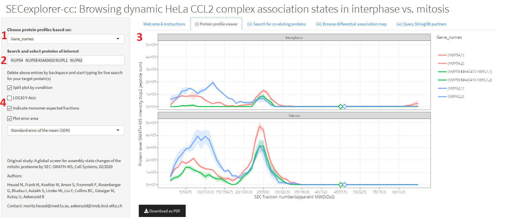

# SECexplorer-cc

R/Shiny app for exploring the HeLa **cell-cycle SEC-SWATH-MS** dataset (interphase vs.
prometaphase): protein elution profiles across conditions, scored assembly-state changes, and
search for co-eluting interaction partners (STRING-guided).

**Live app:** https://sec-explorer.shinyapps.io/hela_cellcycle/

Developed by M. Heusel and M. Frank.

| Module | Function |
|---|---|
| Protein profile viewer | Search proteins (UniProt / gene names), compare chromatograms across conditions, annotation table |
| Score map | Browse proteins by differential assembly-state scores |
| Co-elution search | Find proteins co-eluting with a bait in a chosen condition, overlay STRING partners |



## Run locally

```r
source("install_dependencies.R")   # shiny, plotly, data.table, DT, STRINGdb, CCprofiler, ...
shiny::runApp(".")
```

## Reference

Heusel, M., Frank, M., et al. (2020).
A global screen for assembly state changes of the mitotic proteome by SEC-SWATH-MS.
*Cell Systems* 10, 133–155.e6. https://doi.org/10.1016/j.cels.2020.01.001

Methods: Heusel, M., Bludau, I., Rosenberger, G., Hafen, R., Frank, M., Banaei-Esfahani, A., van Drogen, A., Collins, B.C., Gstaiger, M., Aebersold, R. (2019). Complex-centric proteome profiling by SEC-SWATH-MS. *Mol Syst Biol* 15, e8438. https://doi.org/10.15252/msb.20188438

---
<sub>README optimized with Claude Opus 5.5.</sub>
